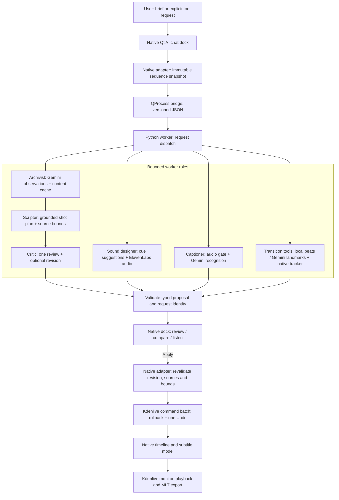

<!-- SPDX-License-Identifier: CC-BY-SA-4.0 -->
<!-- SPDX-FileCopyrightText: 2026 Montaz contributors -->

# Montaz — AI-assisted editing on Kdenlive

Montaz adds an AI chat assistant to Kdenlive's native desktop editor. Describe
your edit, review the proposed shots, and apply them through Kdenlive's timeline
with Undo/Redo. Gemini handles footage analysis, planning, review and speech
recognition. ElevenLabs generates instrumental music and occasional sound effects.

This is an experimental fork based on Kdenlive `v26.08.1`. The implementation
branch is **`codex/ai-assistant-foundation`**. The assistant must be enabled at
build time; packaged Montaz releases are not available yet. Current work focuses
on reliability and output quality; new features are paused.

## What we built

### Native editor and chat

- Moved the editing foundation to Kdenlive: its timeline, project bin, monitor,
  effects, subtitles, rendering and Undo remain authoritative.
- Added a right-aligned **AI** button and a tall chat dock using native Qt actions,
  colors and workspace layouts. The assistant layout keeps the project monitor
  visible and hides the separate clip monitor.
- Added briefs, follow-up refinements, requested duration, travel pacing presets,
  task states, **New brief**, **Stop**, and **Run logs**.
- Kept one optional toolbar: **Add music / Transitions / Captions**. Sounds are
  requested through chat. Transitions are used only when explicitly requested.
- Added reviewed native application: stale project/sequence revisions and replayed
  results are refused; supported changes form one native Undo operation.
- Added **Replace draft** for the session's last assistant edit. It replaces the
  same span while preserving neighboring edits, audio and subtitles. Manual
  changes or unsupported effects/groups make replacement unavailable.

### Footage analysis, scripts and editorial review

- Analyze bounded first/middle/last video windows with Gemini, including visible
  activity, quality and suggested usable trims.
- Cache successful observations by source content, model, analysis version and
  project frame rate; reused or renamed footage avoids repeated analysis.
- Analyze up to two sources concurrently and preserve completed cache entries
  when a later stage fails or the user stops a run.
- Plan visual highlights with **postcard, adventure and diary** pacing. Plans use
  distinct sources, bounded trims, shot reasons and opening/middle/ending guidance.
- Calculate feasible durations and explain shorter results instead of stretching
  or repeating footage to fill the request.
- Run one bounded critic review against cached observations. It can keep or revise
  the draft once; a failed review is explicitly marked unavailable.

### Music and occasional effects

- Generate ElevenLabs instrumental music for the actual visual timeline span.
- Prepare stereo 48 kHz audio with loudness normalization and opening/ending fades;
  validate duration and silence before offering preview and native insertion.
- Reuse raw and prepared audio for matching requests. Unusable short or silent
  provider output is discarded so a later explicit request can generate again.
- Generate a described sound at the playhead, for example
  **“add a 2 second sound of gentle waves.”**
- Suggest sparse sound cues from cached visual observations, with review before
  generation. These are editorial suggestions, not detected location audio.

### Existing transitions

- **Beat-synced cuts:** measure placed music locally and propose bounded cut shifts
  while preserving shot order, source starts, clip identities and total duration.
  Ambiguous rhythm falls back to labelled energy accents.
- **Match cut:** align two selected adjacent video-only shots using Gemini subject
  landmarks and native MLT/OpenCV tracking. Whole-subject spacing and position
  guide bounded Transform keyframes.
- Added source-resolution zoom limits, tracking stability checks, comparison,
  source validation and native Apply/Undo. Incompatible shots receive a no-match
  explanation; every pair is not guaranteed to align.

### Captions

- Recognize bounded original timeline audio and review the text before adding
  Kdenlive subtitles. Video-only footage and silence finish without recognition.
- Cache valid speech results separately from visual evidence.
- Convert timestamps to rational project frames, keep crowded phrases within
  clip bounds, and reject unusable answers before caching them.
- Offer **Clean / Bold / Original** appearance changes without recreating caption
  events or changing their text, IDs or timing.
- Preserve pending caption reviews when a style change is refused or has no effect.

### Reliability and developer tooling

- Use a local Python worker with strict, versioned JSON messages and native
  validation at the mutation boundary.
- Bound provider, media-helper, critic and overall run durations; prevent recursive
  review and automatic generation retry loops.
- On POSIX systems, Stop and editor close terminate the worker's process group,
  including stalled FFmpeg/tracker children.
- Retain the newest 200 redacted run logs with numeric progress/cache/quality
  diagnostics. Missing or invalid keys produce specific errors.
- Add regression fixtures for cancellation, stale/replayed proposals, rollback,
  caption timing, audio preparation, beat detection and tracking.
- Add Craft runtime/resource staging, macOS development launch tooling and an
  optional version-checked Qt Cocoa accessibility workaround.

## Agent architecture

The agents are logical roles implemented as bounded modules in one local worker
per request. The native dock dispatches the requested operation; optional tools
have their own paths. Models return proposals; Kdenlive applies reviewed changes.



| Role | Implementation | Responsibility |
| --- | --- | --- |
| Archivist | `planning.py` | Sample footage, validate observations, reuse content-addressed evidence |
| Scripter | `planning.py` | Select/order/trim shots within footage and pacing constraints |
| Critic | `editorial.py` | Review one draft; reuse evidence and return one bounded revision |
| Sound designer | `sound_cues.py`, `music.py`, `effects.py` | Suggest cues; generate, prepare and validate music/effects |
| Captioner | `captions.py` | Gate silence, recognize speech, cache and allocate subtitle frames |
| Transition tools | `beats.py`, `timing.py`, `match_cuts.py`, native `matchtracker.cpp` | Measure rhythm or track subjects and propose native edits |
| Request lifecycle | `worker.py`, `workerclient.cpp` | Dispatch, strict transport, progress, deadlines, cancellation and redacted logs |
| Native application | `editoradapter.cpp`, `editbatch.cpp` | Capture scope, reject stale results, apply atomically and integrate Undo |

All edit timing uses integer project frames and rational FPS. Python receives
immutable snapshots; Kdenlive owns live state, playback, subtitles and export.
See the [full architecture](dev-docs/montaz/architecture.md) and
[assistant contracts](assistant/README.md).

## Internal foundations and unfinished work

- Cached-evidence shot discovery, local motion/occlusion analysis and versioned
  travel-recipe data are implemented and tested as libraries. They are not exposed
  as complete editor workflows.
- Native 8–12-frame quick-montage contracts, insertion and rollback are implemented
  with synthetic render checks. Discovery, joint framing and a montage UI remain.
- **Whip pan, Object wipe and Speed ramp** are disabled coming-soon entries.
- Match cuts remain a selected-pair prototype; perspective, landmark accuracy and
  crop compatibility limit results.
- Beat estimation does not identify musical downbeats or phrases.
- The visual planner creates video-only edits. Original-speech editing, linked
  audio handling, automatic ducking, generated narration and animated word
  captions remain unfinished.
- Portrait/reframing support is deferred; mixed orientations can show pillarboxing.
- Original caption appearance currently clears a pre-existing custom global
  subtitle override; Undo restores it. Short audio streams can fail captioning.
- Additional generated-audio rollback injection and continuous-playback needle
  checks remain on the [active checklist](dev-docs/montaz/completion-checklist.md).
- Montaz installers and desktop releases are deferred.

## Build and run

Requirements: a compatible Kdenlive C++/Qt/KDE/MLT SDK, Python **3.11+**, and
FFmpeg/ffprobe available to the worker. The assistant's Python package uses the
standard library; native tracking uses the editor's MLT/OpenCV dependencies.

```sh
git clone --branch codex/ai-assistant-foundation https://github.com/tanish1608/kdenlive.git
cd kdenlive

# Run after installing the native dependencies and activating their environment.
cmake -S . -B build -DBUILD_MONTAZ_ASSISTANT=ON -DBUILD_TESTING=ON
cmake --build build --target kdenlive kdenlive_render montaz-tracker assistanttest -j2
```

On macOS, follow the [Craft setup guide](dev-docs/montaz/macos-setup.md), then use
the development launcher from this checkout:

```sh
export MONTAZ_CRAFT_ROOT="$HOME/CraftRoot"
export KDENLIVE_ASSISTANT_PYTHON="$(command -v python3)"
bash assistant/tools/run_craft_macos.sh
```

The launcher uses Craft's configured Kdenlive build and stages runtime resources.
It does not produce an installer. Other platforms should follow the
[upstream build instructions](dev-docs/build.md); the independently exercised
Montaz desktop path is currently Apple Silicon macOS.

## Provider configuration

Use environment variables `GEMINI_API_KEY` and `ELEVENLABS_API_KEY`, or a private
file at `~/.config/montaz/assistant.json`:

```json
{
  "gemini_api_key": "YOUR_GEMINI_API_KEY",
  "elevenlabs_api_key": "YOUR_ELEVENLABS_API_KEY"
}
```

Keep this file outside the checkout and owner-readable/writable (`chmod 600`).
Optional model settings are `GEMINI_MODEL`, `ELEVENLABS_MUSIC_MODEL` and their
JSON equivalents; `MONTAZ_ASSISTANT_CONFIG` overrides the settings path. Choose
models enabled for your provider account. Provider usage requires your own keys.

Gemini receives sampled visual proxies, planning/review context or selected
original audio for the requested operation. ElevenLabs receives generation prompts.
Native transport and run logs exclude provider credentials. Generated audio stays
in the saved project's assets directory and must travel with that project.

## Try the current workflow

1. Import footage, open a sequence and click **AI**.
2. Choose a pacing preset and duration, then send a brief such as
   **“Create a 20-second highlight of the beach and daytime activities.”**
3. Inspect the shots, trims, duration and review result; choose **Apply edit**.
4. Refine the brief to review a replacement, or use native Undo/Redo.
5. Optionally choose **Add music**, preview it and apply it to a free audio track.
6. Request a supported transition explicitly. For Match cut, select two adjacent
   eligible video-only shots. For beat alignment, use an eligible simple edit
   with placed music.
7. Request captions for eligible original audio and review before applying.
8. Save, play back and export through Kdenlive.

Each tool checks timeline eligibility and explains unsupported cases. There is
no mandatory story → music → transition → caption sequence.

## Validation

```sh
# Offline assistant suite: no keys required.
PYTHONPATH=assistant/src python3 -m unittest discover -s assistant/tests -v

# Qt transport, command and chat checks.
python3 assistant/tools/run_native_tests.py --qmake /path/to/Qt/bin/qmake

# Native integration checks, using the SDK runtime environment.
ctest --test-dir build -R '^assistanttest$' --output-on-failure
```

The October 2 maintenance review independently passed **290 Python tests** with
real FFmpeg/tracker enabled, **49 Qt client/command + 7 chat checks**, and native
`assistanttest`. The default Python suite passes 277 tests and skips 13 opt-in
media checks. Set `MONTAZ_TRACKER` and `MONTAZ_FFMPEG` to enable those checks.

Mixed-rate fixtures agree on all 185 project frames across the native timeline,
Undo/Redo, reopened scene and export at both 29.97 and 25 fps. Desktop checks cover
chat routing, no-speech completion, Stop/close terminating children and seeking
across a tested cut. These results do not establish every timeline configuration
or perceptual output quality. See the
[maintenance evidence](dev-docs/montaz/maintenance-integration-review.md) and
[output reviews](dev-docs/montaz/quality-review.md).

## Repository map and contributions

- `src/assistant/`: native dock, transport, adapters, proposal validation and tracker.
- `assistant/src/montaz_assistant/`: Python roles, providers, caches and contracts.
- `assistant/tests/`, `assistant/tools/`: offline/native regressions and private QA tools.
- `src/timeline2/`, `src/monitor/`, `renderer/`: Kdenlive timeline, monitor and rendering.
- `dev-docs/montaz/`: decisions, setup, evidence, collaboration and remaining work.

Read [AGENTS.md](AGENTS.md) and the [active checklist](dev-docs/montaz/completion-checklist.md)
before contributing. Submit Montaz changes to this GitHub fork with focused
commits, a behavior description and relevant validation. Keep credentials, media,
projects, caches and generated audio outside Git. Upstream Kdenlive contributions
belong on [KDE Invent](https://invent.kde.org/multimedia/kdenlive).

## Upstream and licensing

Montaz builds on the work of the Kdenlive, KDE and MLT communities. Kdenlive's
editor and media engine remain the foundation; upstream copyright and license
notices are preserved. See [COPYING](COPYING) and individual file notices;
Montaz assistant code is marked GPL-3.0-or-later and Montaz documentation is
marked CC-BY-SA-4.0. Official Kdenlive releases, documentation and community
information are available at [kdenlive.org](https://kdenlive.org).
